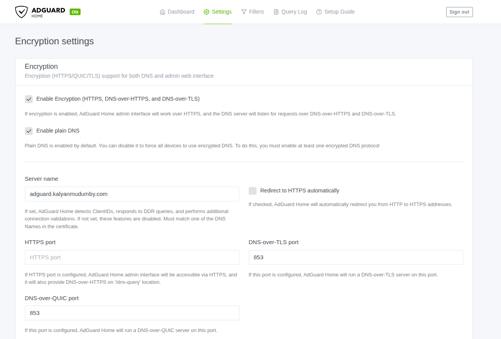
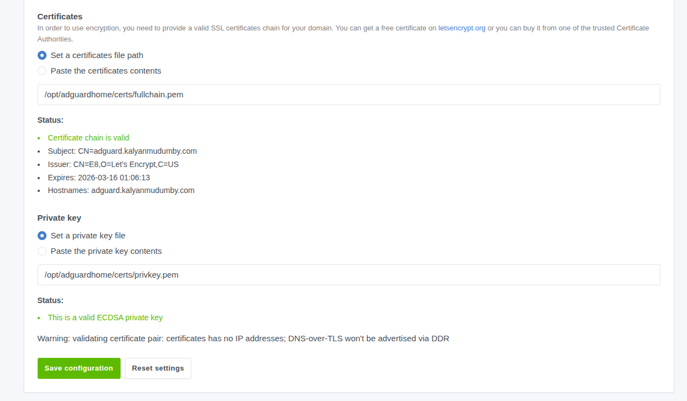
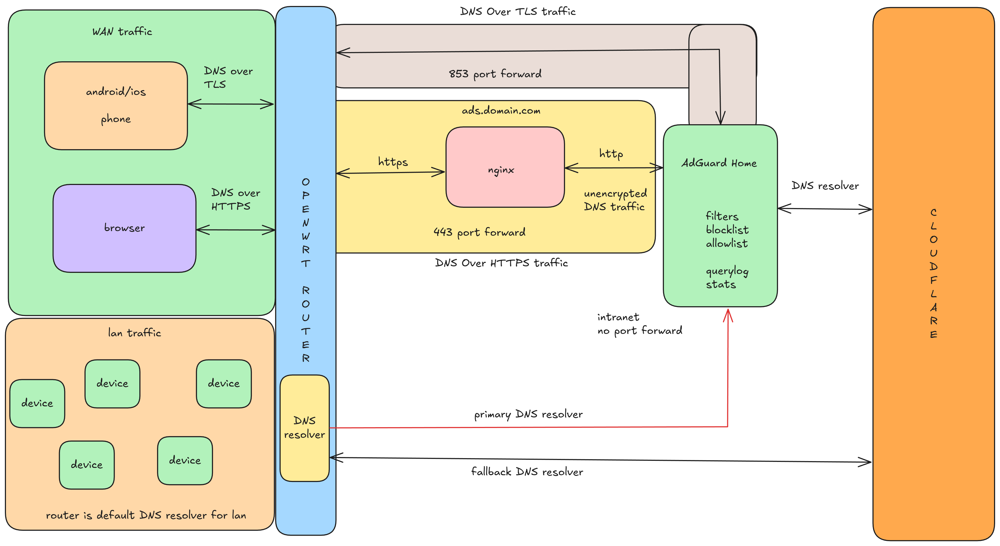
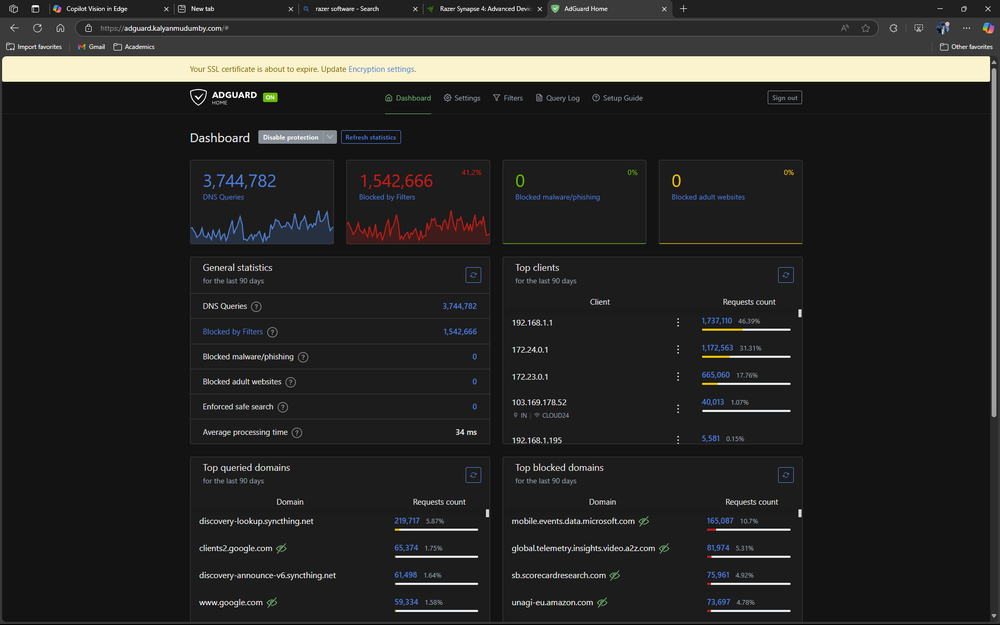

Hello Everyone!

It's been three years since I've written [Let's Install an AdBlocker with PiHole](/post/lets-install-pihole/) where I went in detail on setting up the adblocker for a home network and protect the devices on the Local Area Network (LAN), this is a great lightweight solution to protect all the devices from advertisements and tracking while at home, it really becomes annoying when I'm not at home and bombarded with all the advertisements and a slow browsing experience with all the trackers and invasive popups.



I've was experimenting with [AdGuard Home](https://adguard.com/en/adguard-home/overview.html) on my server a while back, and was really impressed with the performance and the features provided by _AdGuard Home_.

It's really easy to setup _AdGuard Home_ to use it as a DNS Resolver over the public internet, in this post I will explain how to setup the SSL certificates to enable **DoT( DNS Over TLS)** and **DoH (DNS Over HTTPS)**, however let us first try to understand why does DoH and DoT matters at all, and why using the IP address of the DNS resolver is probably a bad idea. 


## What is DNS

The **Domain Name System (DNS)** is often described as the internet’s phonebook. Humans are good at remembering names like `google.com` or `github.com`. Computers, on the other hand, communicate using IP addresses such as `142.250.190.14`. DNS exists to bridge this gap. It translates human-readable domain names into machine-readable IP addresses so your device knows *where* to connect.

This abstraction is one of the reasons the modern internet scales as well as it does. Applications can move between servers, data centers, or even cloud providers without users ever noticing, as long as the domain name remains the same. DNS removes the need to hard-code IP addresses and enables redundancy, failover, and global distribution.

If you’re encountering DNS for the first time, Cloudflare has an excellent and beginner-friendly explanation - [What is DNS](https://www.cloudflare.com/learning/dns/what-is-dns/) - which is a great read.


## Why should you care about your DNS provider?

Every time you visit a website, open an app, or make a network request, your device performs a DNS lookup to resolve the domain name into an IP address. Only after this step does the actual connection to the server begin.

To reduce latency and unnecessary network traffic, DNS responses are cached locally. Each response includes a **TTL (Time To Live)** value that determines how long the result should be considered valid before a fresh lookup is required. This is standard behavior and generally a good thing for performance.

However, this also means one important thing - **Your DNS resolver sees every domain lookup you request.**

Even when the website itself uses HTTPS, DNS queries often occur *before* encryption takes place. This makes DNS metadata extremely valuable. Over time, DNS request patterns can reveal:

- The websites you visit  
- The apps you use  
- Your browsing habits and schedules  
- Your general online interests  

This data is valuable enough that many DNS providers log it, analyze it, and in some cases, monetize it. Combined with cookies, browser fingerprinting, and tracking scripts, DNS data helps advertising companies build detailed behavioral profiles. Ever looked at a product once and seen it follow you around the internet for hours? DNS is one of the many signals that make that possible.

By default, most home routers and devices use DNS resolvers provided by the ISP. These resolvers are often:

- Heavily logged  
- Slow to update  
- Poor at handling modern threats like tracking domains or DNS hijacking  
- Optimized for the ISP’s interests, not yours  

Changing your DNS provider is one of the simplest steps you can take to regain a bit of control over your network traffic. There are many well-known public DNS resolvers available, and you can configure them directly on your router or device. This [List of Popular DNS Servers](https://gist.github.com/mutin-sa/5dcbd35ee436eb629db7872581093bc5) is a good starting point if you want to explore alternatives.


## DNS over TLS (DoT) vs DNS over HTTPS (DoH)

Traditional DNS queries are typically sent in plaintext (most commonly over UDP/TCP port `53`). That makes them easy for networks in the middle - like your ISP, public Wi-Fi, or a corporate firewall - to **observe, log, block, or even modify**. Even if the website itself uses HTTPS, DNS often happens *before* the encrypted connection is established.

Both **DNS over TLS (DoT)** and **DNS over HTTPS (DoH)** fix this by encrypting DNS traffic. The main difference is how the encrypted DNS is transported on the network.

### DNS over TLS (DoT)

**DNS over TLS (DoT)** sends DNS queries over a dedicated, encrypted TLS connection, typically using port `853`. It is a purpose-built solution that focuses on securing DNS traffic without changing how DNS fundamentally works. Because of this simplicity, DoT works particularly well on routers, gateways, and home network setups where DNS configuration is centralized and rarely changes. From an operational standpoint, it is also easier to reason about and troubleshoot since DNS traffic is clearly separated and identifiable at the network level.

However, the same characteristics that make DoT clean and explicit also make it easier to interfere with. Since it relies on a well-known port, DoT traffic is trivial for restrictive networks or ISPs to detect and block. Tightly controlled environments may prevent DoT from working altogether, forcing clients to fall back to plaintext DNS or fail resolution entirely.

### DNS over HTTPS (DoH)

**DNS over HTTPS (DoH)** encrypts DNS queries by encapsulating them inside standard HTTPS traffic over port `443`. Because it uses the same transport as normal web traffic, DoH blends in seamlessly with everyday HTTPS connections. This makes it far more resilient on public Wi-Fi networks, corporate environments, hotels, and campuses where non-standard ports are often blocked or monitored. For this reason, DoH has seen widespread adoption in modern browsers and operating systems.

The downside of this approach is that DNS traffic becomes much harder to distinguish from regular HTTPS at the network level. While this improves privacy and censorship resistance, it can complicate debugging and visibility for network administrators. Additionally, depending on how a system is configured, DNS resolution may happen at the application level rather than system-wide, which can lead to differences in behavior between browsers and other applications.

Either way, both are a major upgrade over plaintext DNS and help prevent casual surveillance and DNS tampering between your device and the resolver.

I’ve seen a similar pattern with VPNs on restrictive networks where protocols like [WireGuard](https://www.wireguard.com/) are blocked, **OpenVPN over TCP on port `443`** often has a better chance of working simply because it shares the same port as normal HTTPS traffic. Blocking port `443` outright would break a large part of the web, so many networks avoid doing that. That’s also why **DoH tends to be more resilient than DoT** on locked-down networks - it rides inside standard HTTPS. This is not foolproof though: with **[Deep Packet Inspection (DPI)](https://en.wikipedia.org/wiki/Deep_packet_inspection)**, **[TLS Fingerprinting](https://fingerprint.com/blog/what-is-tls-fingerprinting-transport-layer-security/)**, and **[Traffic Analysis](https://en.wikipedia.org/wiki/Traffic_analysis)**, administrators can still detect and block these connections. The key point is that HTTPS-based transport usually raises the cost of blocking, rather than making it impossible.


For a deeper explanation, here are some excellent resources:
- [What is DNS over TLS (DoT)?](https://www.cloudflare.com/learning/dns/dns-over-tls/)
- [What is DNS over HTTPS (DoH)?](https://www.cloudflare.com/learning/dns/dns-over-https/)
- [What Is Deep Packet Inspection (DPI)?](https://www.fortinet.com/resources/cyberglossary/dpi-deep-packet-inspection)
- [TLS fingerprinting: What it is and how it works](https://fingerprint.com/blog/what-is-tls-fingerprinting-transport-layer-security/)

## Let’s Install AdGuard Home (with DoH + DoT)

### Requirements

* **A machine to run AdGuard-Home on**: Raspberry Pi, VPS, or a VM in your homelab.
* **A domain name** (recommended) and a DNS provider you control.
* **A stable way to reach the server**: Static public IP or **DDNS** (Dynamic DNS) that keeps your domain updated when your IP changes.
* **Network access**:

  * If this is in a homelab behind a router, you’ll need port forwarding.
  * If it’s a VPS, make sure the cloud firewall/security group allows the ports.

**Ports we'll typically need**:

* `443/tcp` - DoH + HTTPS via Nginx
* `853/tcp` - DoT
* `22/tcp` - SSH



**Warning** If you use Cloudflare for DNS, your `adguard.example.com` record must be **DNS-only** (gray cloud). Cloudflare does not proxy arbitrary TCP like `853` on the free plan, so DoT won’t work through the orange cloud (proxy)


---

### Initial setup (Ubuntu/Debian)

I’m using an Ubuntu server here. If you’re on Debian-based distros, this is the easy path:

```bash
sudo apt update
sudo apt install -y nginx ufw snapd
```

If you are using a different linux distro you and modify the above commands accordingly for your package manager.

### Install Docker

We’ll run AdGuard Home in Docker because it’s easier to deploy, upgrade, and maintain. 

Follow Docker’s official guide to install Docker for Ubuntu:

* [https://docs.docker.com/engine/install/ubuntu/](https://docs.docker.com/engine/install/ubuntu/)


### Issue an SSL certificate (Let’s Encrypt)

To enable **DoH** and **DoT**, we need a SSL certificate issued in for our domain, We’ll use Let’s Encrypt to issue a certificate in this post.

### Install Certbot (via snap)

```bash
sudo snap install --classic certbot
sudo ln -s /snap/bin/certbot /usr/bin/certbot
```

### Get a certificate

```bash
sudo certbot certonly --manual --preferred-challenges=dns --preferred-chain="ISRG Root X1"
```

Certbot will ask you to create a **TXT** record like `_acme-challenge.adguard`. Add it at your DNS provider, wait for it to propagate, and continue.


**Warning**: Keep a close eye on your certificate expiration dates. If the certificate expires, both DoH and DoT will stop working and clients may start throwing errors like DNS_PROBE_FAILED. Let’s Encrypt certificates are valid for 90 days, so make sure you have a renew your certificates before they expire and your before internet mysteriously breaks. (Been there before).



### Configure UFW (host firewall)

UFW defaults are important. You want to deny **incoming** traffic by default, not outgoing.

```bash
sudo systemctl enable --now ufw

sudo ufw default deny incoming
sudo ufw default allow outgoing

sudo ufw allow 22/tcp    # SSH
sudo ufw allow 443/tcp   # HTTPS
sudo ufw allow 853/tcp   # DoT

# Optional: only if you want classic DNS (port 53) exposed publicly
# sudo ufw allow 53/udp
# sudo ufw allow 53/tcp
# We won't connect to our adguard instance over the default 53 port in this post.

sudo ufw status
```


### Run AdGuard Home with Docker Compose

We’ll run AdGuard Home and keep its config/data on disk using docker volume mounts so that container upgrades don’t wipe our configuration and settings.

### Create directories

```bash
mkdir -p ~/adguard/{work,conf}
cd ~/adguard
```

### Docker Compose

This setup keeps the AdGuard UI and DoH backend bound to **localhost** only, and lets **Nginx** be the public HTTPS entrypoint.

Create `docker-compose.yml`:

```yaml
services:
  adguardhome:
    image: adguard/adguardhome:latest
    container_name: adguardhome
    restart: unless-stopped
    user: "0:0"

    ports:
      # First-run wizard (temporary). Bind to localhost so it’s not exposed publicly.
      - "3000:3000/tcp"

      # AdGuard web UI (after initial setup). Bind to localhost; Nginx will proxy it.
      #- "3000:80/tcp"

      # DoT (public)
      - "853:853/tcp"

      # Optional: classic DNS (public) NOT RECOMMENDED
      # - "53:53/tcp"
      # - "53:53/udp"

    volumes:
      - ./work:/opt/adguardhome/work
      - ./conf:/opt/adguardhome/conf

      # Mount Let’s Encrypt certs read-only
      - /etc/letsencrypt/live/your.domain/fullchain.pem:/opt/adguardhome/certs/fullchain.pem:ro
      - /etc/letsencrypt/live/your.domain/privkey.pem:/opt/adguardhome/certs/privkey.pem:ro
```

Start it:

```bash
docker compose up -d
```

Then access the wizard in your browser using the configured domain, after the setup comment the `3000:3000` mapping line and uncomment the `3000:80` port mapping line in `docker-compose.yaml` file.



After initial setup, AdGuard typically moves the UI to port `80` inside the container (mapped as `3000:80`).



### Configure Nginx as the HTTPS reverse proxy

We’re using Nginx as a reverse proxy as binding port 443 directly to a single application is wasteful when one server can comfortably host multiple services. With a reverse proxy, you can run several apps on the same machine, all sharing 443, and route traffic based on the domain name (and path).

Create a site config (example: `/etc/nginx/sites-available/adguard`):

```nginx
server {
    listen 80;
    listen [::]:80;
    server_name adguard.your.domain;

    # Redirect everything to HTTPS
    location / {
        return 301 https://$host$request_uri;
    }
}

server {
    listen 443 ssl http2;
    listen [::]:443 ssl http2;
    server_name adguard.your.domain;

    ssl_certificate     /etc/letsencrypt/live/adguard.your.domain/fullchain.pem;
    ssl_certificate_key /etc/letsencrypt/live/adguard.your.domain/privkey.pem;

    client_max_body_size 20m;
    proxy_buffering off;

    # DoH endpoint
    location = /dns-query {
        proxy_pass http://localhost:3000/dns-query;
        proxy_http_version 1.1;

        proxy_set_header Host              $host;
        proxy_set_header X-Real-IP         $remote_addr;
        proxy_set_header X-Forwarded-For   $proxy_add_x_forwarded_for;
        proxy_set_header X-Forwarded-Proto $scheme;
    }

    # AdGuard UI
    location / {
        proxy_pass http://localhost:3000;
        proxy_http_version 1.1;

        proxy_set_header Host              $host;
        proxy_set_header X-Real-IP         $remote_addr;
        proxy_set_header X-Forwarded-For   $proxy_add_x_forwarded_for;
        proxy_set_header X-Forwarded-Proto $scheme;
        proxy_set_header Upgrade $http_upgrade;
        proxy_set_header Connection "upgrade";
    }
}
```

Enable the config:

```bash
sudo ln -s /etc/nginx/sites-available/adguard /etc/nginx/sites-enabled/adguard
sudo nginx -t
sudo systemctl reload nginx
```

---

### Configure DoT and DoH in AdGuard Home

At this point:

* UI should be reachable at: `https://adguard.your.domain`
* DoH will be served at: `https://adguard.your.domain/dns-query`


### DoT (DNS over TLS)

In the AdGuard Home UI (Settings → Encryption), enable DoT and DoH and point it to the certificate files you mounted:

* Certificate: `/opt/adguardhome/certs/fullchain.pem`
* Key: `/opt/adguardhome/certs/privkey.pem`







### DoH behind Nginx (plaintext upstream)

Because Nginx terminates TLS, AdGuard will receive DoH traffic over HTTP on `3000`. For that, AdGuard must allow unencrypted DoH upstream.

In `~/adguard/conf/AdGuardHome.yaml`, set:

```yaml
tls:
  allow_unencrypted_doh: true
```

Then restart AdGuard:

```bash
docker compose restart adguardhome
```

If you followed the steps above, you should now have DoT and DoH working end-to-end.



If your AdGuard instance is running inside your home network, you can use it as the primary DNS resolver for your LAN by pointing your router (or DHCP) to it. Do not expose port 53 (plain DNS) to the public internet. If you need DNS while you’re away, prefer DoH/DoT (or a VPN) instead of publishing a raw DNS service port.



## Why you should avoid exposing port 53

Port `53` is the traditional port used for DNS, and most DNS traffic over it is **unencrypted by default**. Because DNS over port `53` is so common and predictable, it is also a frequent target for abuse. Open resolvers exposed on `53` are routinely scanned, fingerprinted, and abused for amplification attacks, spoofing, and cache poisoning. Even when access is restricted, plaintext DNS remains vulnerable to manipulation techniques such as DNS hijacking and NXDOMAIN injection.

For these reasons, exposing port `53` to the public internet is strongly discouraged. If you need remote DNS access, prefer **DNS over TLS (DoT)** or **DNS over HTTPS (DoH)**, which encrypt queries and significantly raise the bar against surveillance and tampering. Plain DNS should be limited to trusted local networks where traffic does not traverse untrusted intermediaries.

## Next Steps

Please visit my older blog post [Let's Install an AdBlocker with PiHole](../../post/lets-install-pihole/index.md) where I go in details about configuring block lists, everyone has different needs to run a DNS level sink hole, so you have to experiment with what works for you and what list breaks your apps after a few tweaks and exploring the AdGuard-Home you can settle down on a config that works best for you.

### Experiment with Unbound

If you’ve made it this far, you’ve already taken a big step toward improving your DNS privacy by moving away from plaintext DNS and exposing only **DoH/DoT**. A natural next experiment is to look at *where* your filtered DNS queries ultimately go.

Using a public resolver like Cloudflare is convenient and fast, but it still means your DNS traffic eventually ends up at a large third-party service. If you want to push your setup one step further, consider replacing the upstream public resolver with a **local recursive resolver such as Unbound**.

With Unbound, AdGuard Home no longer forwards queries to a single external provider. Instead, Unbound resolves domains directly by querying authoritative DNS servers on the internet. This reduces reliance on centralized resolvers and limits how much of your DNS activity is visible to any single organization. 

While using UnBound as your primary DNS Resolver, AdGuard continues to handle blocking and logging, while Unbound focuses purely on secure DNS resolution.


## My Setup




In this previous setup, my **OpenWrt-based router** sits at the center. For LAN devices, OpenWrt acts as the default DNS resolver via DHCP and forwards queries internally to AdGuard Home without exposing plain DNS (`53`) to the internet. For WAN access, the router forwards only the required encrypted ports - `443` for DoH and `853` for DoT - to the AdGuard host. This keeps DNS on port `53` confined to the trusted local network while allowing secure, encrypted DNS access from external devices.


Here are some stats from when I was running my AdGuard Instance in my Home Network as my primary DNS resolver and my DoH and DoT endpoint.




## Conclusion

Thank you for reading until the very end.

I genuinely hope you find some joy in taking control over the little things you interact with in this digital world - because these “little things” affect our day-to-day experience online. Setting up AdGuard Home is one of those changes that you don’t think about after a week, only until you use a network without it and suddenly everything feels slower, and a lot more invasive.

When I did my first AdGuard-Home install about three years ago, I ended up learning way more about certificates than I expected. It honestly made me appreciate the amount of effort and engineering that goes into PKI (Public Key Infrastructure) - the fact that we can rely on certificate authorities and trust chains to make secure communication possible at internet scale is kind of wild. You only really notice it when something breaks, and then you realize how much of the modern web is built on this foundation.

This post was primarily focused on configuring **DoH** and **DoT**, because there’s already plenty of content out there on the general AdGuard setup, and the UI is pretty intuitive anyway. The encryption part is where most I got stuck for hours during my first install, this blog post is my documentation of the process, and I hope it helps others along the way as well.

If you want a good next step, try experimenting with **Unbound** as your upstream resolver instead of a public DNS provider - it’s a great way to take this setup one level further and improve privacy even more.

Here’s a slide deck I made on this topic earlier [Presentation on AdGuard Home](./Presentation%20on%20AdGuard.pdf)


## References
- [AdGuard Wiki](https://github.com/AdguardTeam/AdGuardHome/wiki)
- [Certbot](https://certbot.eff.org/)
- [What is DNS? – Cloudflare](https://www.cloudflare.com/learning/dns/what-is-dns/)
- [List of Popular DNS Servers (GitHub Gist)](https://gist.github.com/mutin-sa/5dcbd35ee436eb629db7872581093bc5)
- [What is DNS over TLS (DoT)? – Cloudflare](https://www.cloudflare.com/learning/dns/dns-over-tls/)
- [Dynamic DNS (DDNS) – Cloudflare](https://www.cloudflare.com/learning/dns/glossary/dynamic-dns/)
- [Deep Packet Inspection – Wikipedia](https://en.wikipedia.org/wiki/Deep_packet_inspection)
- [Traffic Analysis – Wikipedia](https://en.wikipedia.org/wiki/Traffic_analysis)
- [What Is Deep Packet Inspection (DPI)? – Fortinet](https://www.fortinet.com/resources/cyberglossary/dpi-deep-packet-inspection)
- [TLS Fingerprinting: What It Is and How It Works](https://fingerprint.com/blog/what-is-tls-fingerprinting-transport-layer-security/)
- [Docker Engine Installation (Ubuntu)](https://docs.docker.com/engine/install)
- [Let’s Encrypt](https://letsencrypt.org/)
- [Let’s Encrypt and DNS over TLS Hell on Android](https://ikarus.sg/lets-encrypt-dot-android/)