There are three pillars of observability of an application

* [Monitoring](#monitoring)
* [Tracing](#tracing)
* [Logging](#logging)

before integrating these tools into our applications, it is crucial to understand these tools and the purpose they will serve throughout the application lifecycle.

## Monitoring

Think of monitoring as your application's health dashboard. It answers the question, "How is the system doing overall?" By collecting high-level metrics like CPU usage, memory consumption, and request rates over time, monitoring gives you a bird's-eye view of your system's performance and resource utilization. It's perfect for identifying trends, spotting resource saturation, and setting alerts for when things go wrong.

Here are common metrics:

- CPU Usage
- Memory Usage
- Disk Usage
- Requests Received
- Network  In
- Network Out

Depending on the Programming Lanuguage, Application and the framework being used, you can extract more detailed and granular information from the above mentioned list, you can also make your own custom metrics to analyze certain tasks which are necessary to monitor.

## Tracing

If monitoring is the bird's-eye view, tracing tells the detailed story of a single request's journey through your distributed system. It answers the question, "What happened during this specific operation?" By assigning a unique ID to a request as it enters your system, distributed tracing follows it through every service it touches, from the front-end to the deepest database call. This allows you to pinpoint exactly where latency is introduced and which component is responsible for an error.

It is important to note that if the frontend is not equipped with the tracing support we would only be able to monitor the application from the moment it interacts with our backend service.

Tracing enables us to

- measure latency from request to response
- measure resources used by certain routes or functions.
- measure time spent at each function or API call.

This amount of information when visualised with a tool like grafana allows us to find patterns and identify bottlenecks within our application and environment

## Logging

Logs are the immutable, timestamped diary of your application. They answer the question, "What did the code do at this exact moment?" Unlike metrics or traces, logs provide granular, developer-defined context about specific events. Whether it's an error with a full stack trace, a debug message showing a variable's state, or a record of a user's action, logs are the ground-truth evidence you need to reconstruct events and debug complex application logic.

## OpenTelemetry

[OpenTelemetry](https://opentelemetry.io/) (OTel) is an open-source project under the Cloud Native Computing Foundation (CNCF) that provides a unified, vendor-neutral standard for your telemetry data. Instead of instrumenting your application separately for logs, traces, and metrics, you do it once with OpenTelemetry.

The best part of OTel is that it decouples your application's instrumentation from the backend tools you use to analyze the data. This means you can switch from Loki to another logging platform, or from Tempo to Jaeger, by changing a configuration file in one central place, without ever touching your application's code. This avoids vendor lock-in and dramatically simplifies managing observability in complex environments.

In this tutorial, we will use two key OpenTelemetry components:

1.  **The OTel Java Agent:** A JAR file that we attach to our Spring Boot application at runtime. It automatically "instruments" our code without requiring any code changes, capturing traces, metrics, and even automatically adding trace IDs to our logs.
2.  **The OTel Collector:** A central service that runs in our Docker stack. It receives all the telemetry data from the Java agent and is responsible for processing it and exporting it to the correct backends: traces to Tempo, logs to Loki, and metrics to Prometheus.

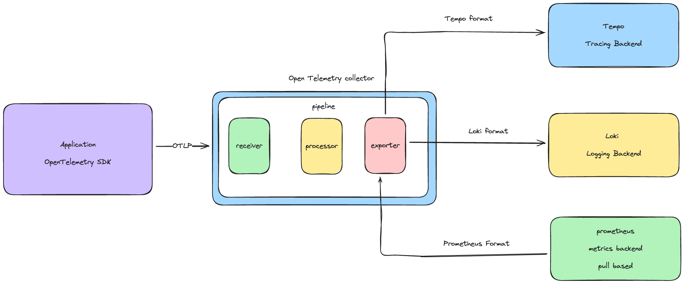

The diagram above illustrates the internal **Pipeline** of the OpenTelemetry Collector, which consists of three distinct stages:

1.  **Receivers:** The entry point for data. In our case, the collector *receives* telemetry data from the application via the **OTLP** protocol.
2.  **Processors:** An intermediate stage where data can be modified, batched, or filtered before being sent out.
3.  **Exporters:** The final stage where data is formatted and sent to specific backends. As shown, the collector exports traces to **Tempo**, logs to **Loki**, and exposes metrics for **Prometheus** to scrape (pull-based).

For a great deep dive, check out this video from the OpenTelemetry team:



## Prerequisites

Before we begin, this guide assumes you have a working Spring Boot application that you can build into a JAR file. You will adapt the provided `Dockerfile` to work with your application.

### Directory Structure

For this tutorial to work, all the configuration files we create (`docker-compose.yml`, `prometheus.yml`, etc.) must be in the same directory. Create a directory for your observability stack with the following structure:

```
observability-stack/
├── docker-compose.yml
├── loki.yml
├── otel-collector.yml
├── prometheus.yml
└── tempo.yml
```

### Network Setup

All of our services will communicate over a dedicated Docker network. Create it with the following command:

```sh
docker network create monitoring
```


## Spring Boot Setup

In this post, we will be configuring **Loki** for logging, **Tempo** for tracing, **Prometheus** for metrics, and **Grafana** for visualization. You are free to use any tracing, metrics, or logging provider as you wish; with OpenTelemetry, it becomes easy to switch between providers.

To expose metrics from our application, we require the micrometer dependency. To enable the [Micrometer Application Observability](https://micrometer.io/), we need to add the Spring Boot Actuator and the Micrometer Registry to our dependencies. Here are the dependencies for `pom.xml`:

```xml
<dependency>  
    <groupId>org.springframework.boot</groupId>  
    <artifactId>spring-boot-starter-actuator</artifactId>  
</dependency>  
<dependency>  
    <groupId>io.micrometer</groupId>  
    <artifactId>micrometer-registry-prometheus</artifactId>  
    <scope>runtime</scope>  
</dependency>
```

Now that our application exposes metrics, we will add the [OpenTelemetry Java Agent](https://opentelemetry.io/docs/zero-code/java/agent/) to run alongside our application. It collects metrics and traces and sends them to the OpenTelemetry Collector instance.

To enable the agent, we need to attach it to the application JAR at runtime. This is handled in the `Dockerfile` below. For more details, refer to the [Application Server Configuration](https://opentelemetry.io/docs/zero-code/java/agent/server-config/) documentation.

```Dockerfile
FROM maven:3-eclipse-temurin-21-alpine AS bob-the-builder
LABEL authors="kalyanmudumby"
WORKDIR /build
COPY pom.xml .
RUN mvn dependency:resolve && mvn dependency:resolve-plugins
COPY . .
ARG ENV
RUN if [ -z "$ENV" ]; then mvn install -Pdefault; else mvn install -P"$ENV"; fi

FROM eclipse-temurin:21-alpine
# Download the OpenTelemetry Java Agent
RUN wget -O otel.jar https://github.com/open-telemetry/opentelemetry-java-instrumentation/releases/download/v2.9.0/opentelemetry-javaagent.jar

# CONFIGURABLE ENVIRONMENT VARIABLES
ENV SERVICE_NAME="OPTIMUS"
ENV CLIENT_NAME="EARTH"
ARG OTEL_ENDPOINT
ENV INGESTOR_ENDPONT=$OTEL_ENDPOINT

# DO NOT EDIT
ENV OTEL_EXPORTER_OTLP_ENDPOINT=$INGESTOR_ENDPONT
ARG ENV="development"
RUN echo $ENV

# OpenTelemetry Configuration
ENV OTEL_RESOURCE_ATTRIBUTES="service.name=$SERVICE_NAME-${ENV},environment=${ENV},client=$CLIENT_NAME"
ENV OTEL_TRACES_SAMPLER="always_on"
ENV OTEL_INSTRUMENTATION_MICROMETER_ENABLED=true
ENV OTEL_INSTRUMENTATION_COMMON_DB_STATEMENT_SANITIZER_ENABLED=true
ENV OTEL_INSTRUMENTATION_LOGBACK_ENABLED=true
ENV OTEL_METRIC_EXPORT_INTERVAL=10000
ENV OTEL_METRICS_EXEMPLAR_FILTER=ALWAYS_ON
ENV JAVA_OPTS="-javaagent:otel.jar"
COPY --from=bob-the-builder /build/target/documan*.jar application.jar
ENTRYPOINT ["java","-javaagent:otel.jar","-jar","application.jar"]
```

This is a multi-stage docker build file which attaches the agent during runtime with some default configuration.


> **Warning: Not for Production!**
> The `Dockerfile` above is configured for a local demo.
> *   `OTEL_TRACES_SAMPLER="always_on"` is great for seeing all your trace data during development, but it will be very expensive and can hurt performance in a production environment.


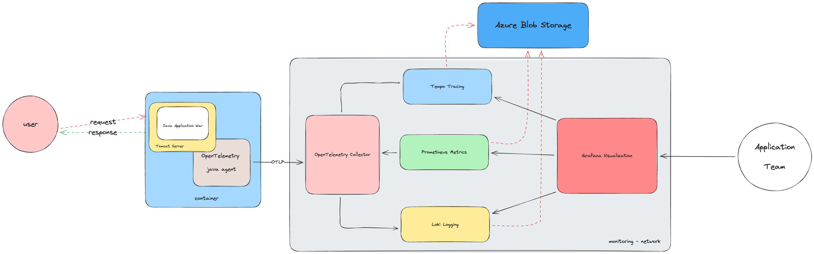

The diagram above illustrates a robust observability pipeline. Here, the **OpenTelemetry Java Agent** is embedded within the application container, capturing all telemetry data and transmitting it via OTLP to a central **OpenTelemetry Collector**. The Collector acts as a router, dispatching traces to **Tempo**, metrics to **Prometheus**, and logs to **Loki**.

The above system would ideally use a **Azure Blob Storage** or similar block/blog storage for long-term retention of traces, logs and metrics. While this is the ideal setup for production to ensure durability and scalability, our tutorial will use **local filesystem storage** to keep the configuration simple and easy to run locally.

## Configuring the Observability Stack

### Prerequisites

Before we define our services, we need to create a dedicated Docker network. This allows our containers to communicate with each other using their service names (Docker DNS resolution).

Run the following command to create the network:

```sh
docker network create monitoring
```

Ensure you are in the `observability-stack/` directory we created earlier. All the configuration files (`docker-compose.yml`, `otel-collector.yml`, etc.) should be placed here.

### Setting Up Grafana, Prometheus, Loki, and Tempo

Create a file named `docker-compose.yml` with the following content. This defines all the services we need for our observability backend.

```yaml
services:
  otel-collector:
    container_name: otel-collector
    image: otel/opentelemetry-collector-contrib:0.101.0
    restart: always
    command:
      - --config=/etc/otelcol-cont/otel-collector.yml
    volumes:
      - ./otel-collector.yml:/etc/otelcol-cont/otel-collector.yml
    ports:
      - "1888:1888" # pprof extension
      - "8888:8888" # Prometheus metrics exposed by the collector
      - "8889:8889" # Prometheus exporter metrics
      - "13133:13133" # health_check extension
      - "4317:4317" # OTLP gRPC receiver
      - "4318:4318" # OTLP http receiver
      - "55679:55679" # zpages extension
    networks:
      - monitoring
  prometheus:
    container_name: prometheus
    image: prom/prometheus
    restart: always
    command:
      - '--config.file=/etc/prometheus/prometheus.yml'
      - '--storage.tsdb.path=/prometheus'
      - '--enable-feature=exemplar-storage'
      - '--web.enable-remote-write-receiver'
      - '--storage.tsdb.retention.time=31d'
      - '--web.console.libraries=/etc/prometheus/console_libraries'
      - '--web.console.templates=/etc/prometheus/consoles'
      - '--web.enable-lifecycle'
    volumes:
      - ./prometheus.yml:/etc/prometheus/prometheus.yml
      - ./prometheus_data:/prometheus
    ports:
      - "9090:9090"
    networks:
      - monitoring
  tempo:
    container_name: tempo
    image: grafana/tempo:latest
    command: [ "-config.file=/etc/tempo.yml" ]
    volumes:
      - ./tempo.yml:/etc/tempo.yml
      - ./tempo:/tmp/tempo
    ports:
      - "3200:3200"   # tempo
      - "4317"  # otlp grpc
    networks:
      - monitoring
  loki:
    container_name: loki
    image: grafana/loki:latest
    command: -config.file=/etc/loki/local-config.yaml
    volumes:
      - ./loki.yml:/etc/loki/local-config.yaml
      - ./loki:/tmp/loki
    ports:
      - "3100:3100"
    networks:
      - monitoring
  grafana:
    container_name: grafana
    image: grafana/grafana:latest
    ports:
      - "3000:3000"
    volumes:
      - ./grafana-data:/var/lib/grafana:rw
    networks:
      - monitoring
networks:
  monitoring:
    external: true
```

Once you have created all the configuration files (we will define `otel-collector.yml`, `loki.yml`, `tempo.yml`, and `prometheus.yml` in the next sections), you can start the stack with:

```sh
docker-compose up -d
```

To confirm that Grafana is up and running, visit `http://localhost:3000`.


### OpenTelemetry Collector

The following configuration configures opentelemetry to push data to tempo, loki and exposes a endpoint where prometheus can scrape the data from, we also configure it to generate the span metrics and service graph.

```yaml
receivers:
  otlp:
    protocols:
      grpc:
      http:
processors:
  batch:
connectors:
  servicegraph:
    latency_histogram_buckets: [0.1, 0.2, 0.4, 0.8, 1.6, 3.2, 6.4, 12.8]
  spanmetrics:
    namespace: traces.spanmetrics
    histogram:
      explicit:
        buckets: [2ms, 4ms, 8ms, 16ms, 32ms, 64ms, 128ms, 256ms, 512ms, 1.02s, 2.05s, 4.10s]
exporters:
  logging:
    loglevel: debug
  prometheus:
    endpoint: "0.0.0.0:8889"
  otlphttp:
    endpoint: http://tempo:4318 
    tls:
      insecure: true
  loki:
    endpoint: "http://loki:3100/loki/api/v1/push"

extensions:
  health_check:
  pprof:
  zpages:
service:
  extensions: [health_check, pprof, zpages]
  pipelines:
    metrics:
      receivers: [otlp,servicegraph,spanmetrics]
      processors: [batch]
      exporters: [prometheus]
    traces:
      receivers: [otlp]
      processors: [batch]
      exporters: [otlphttp,spanmetrics,servicegraph]
    logs:
      receivers: [otlp]
      exporters: [loki]
```

### Loki Logging

Let's configure Loki, we have configured the stream limits and data retention period here along with some chunk level configuration, visit Loki documentation page to understand it better and configure it according to your needs

```yaml
auth_enabled: false
server:
  http_listen_port: 3100
common:
  path_prefix: /tmp/loki
  storage:
    filesystem:
      chunks_directory: /tmp/loki/chunks
      rules_directory: /tmp/loki/rules
  replication_factor: 1
  ring:
    instance_addr: 127.0.0.1
    kvstore:
      store: inmemory
schema_config:
  configs:
    - from: 2020-09-07
      store: tsdb
      object_store: filesystem
      schema: v13
      index:
        prefix: loki_index_
        period: 24h
limits_config:
  retention_period: 744h
  ingestion_rate_mb: 128
  ingestion_burst_size_mb: 256
  per_stream_rate_limit: 64MB
  per_stream_rate_limit_burst: 128MB
  allow_structured_metadata: false
ingester:
  chunk_idle_period: 2m
  max_chunk_age: 2m
  chunk_target_size: 1536000
  chunk_retain_period: 30s
```

> **Warning: Not for Production!**
> This Loki configuration uses the local filesystem for storage (`storage.filesystem`) and a long retention period (`744h`). This is suitable for local testing, but for production, you must configure a durable object storage backend like Amazon S3, Google Cloud Storage, or Azure Blob Storage to prevent data loss.

### Tempo Tracing

Let's configure Tempo, we have configured tempo to generate us exemplars and also span metrics stream limits and data retention period here along with some chunk level configuration, visit Tempo documentation page to understand it better and configure it according to your needs

```yaml
# For more information on this configuration, see the complete reference guide at
# https://grafana.com/docs/tempo/latest/configuration/

# Enables result streaming from Tempo (to Grafana) via HTTP.
stream_over_http_enabled: true
server:
  http_listen_port: 3200
distributor:
  receivers:             # This configuration will listen on all ports and protocols that tempo is capable of.
    jaeger:              # The receivers all come from the OpenTelemetry collector.  More configuration information can
      protocols:         # be found there: https://github.com/open-telemetry/opentelemetry-collector/tree/main/receiver
        thrift_http:     #
        grpc:            # For a production deployment you should only enable the receivers you need!
        thrift_binary:   #
        thrift_compact:
    otlp:
      protocols:
        http:
          endpoint: "0.0.0.0:4318"
        grpc:
          endpoint: "0.0.0.0:4317"
    zipkin:              # Receive trace data in any supported Zipkin format.
# The ingester receives data from the distributor and processes it into indices and blocks.
ingester:
  trace_idle_period: 1m       # The length of time after a trace has not received spans to consider it complete and flush it.
  max_block_bytes: 1_000_000   # Cut the head block when it hits this size or
  max_block_duration: 2m       # this much time passes
# The compactor block configures the compactor responsible for compacting TSDB blocks.
compactor:
  compaction:
    compaction_window: 1h              # Blocks in this time window will be compacted together.
    max_block_bytes: 100_000_000       # Maximum size of a compacted block.
    block_retention: 24h                # How long to keep blocks. Default is 14 days, this demo system is short-lived.
    compacted_block_retention: 774h     # How long to keep compacted blocks stored elsewhere.
# Configuration block to determine where to store TSDB blocks.
storage:
  trace:
    backend: local                     # Use the local filesystem for block storage. Not recommended for production systems.
    block:
      bloom_filter_false_positive: .05 # Bloom filter false positive rate.  lower values create larger filters but fewer false positives.
    # Write Ahead Log (WAL) configuration.
    wal:
      path: /tmp/tempo/wal             # Directory to store the the WAL locally.
    # Local configuration for filesystem storage.
    local:
      path: /tmp/tempo/blocks          # Directory to store the TSDB blocks.
    # Pool used for finding trace IDs.
    pool:
      max_workers: 100                 # Worker pool determines the number of parallel requests to the object store backend.
      queue_depth: 10000               # Maximum depth for the querier queue jobs. A job is required for each block searched.
# Configures the metrics generator component of Tempo.
metrics_generator:
  # Specifies which processors to use.
  processor:
    # Span metrics create metrics based on span type, duration, name and service.
    span_metrics:
        # Configure extra dimensions to add as metric labels.
        dimensions:
          - http.method
          - http.target
          - http.status_code
          - service.version
    # Service graph metrics create node and edge metrics for determinng service interactions.
    service_graphs:
        max_items: 50000
        # Configure extra dimensions to add as metric labels.
        dimensions:
          - http.method
          - http.target
          - http.status_code
          - service.version
  # The registry configuration determines how to process metrics.
  registry:
    collection_interval: 5s                 # Create new metrics every 5s.
    # Configure extra labels to be added to metrics.
    external_labels:
      source: tempo                         # Add a `{source="tempo"}` label.
      group: 'mythical'                     # Add a `{group="mythical"}` label.
  # Configures where the store for metrics is located.
  storage:
    # WAL for metrics generation.
    path: /tmp/tempo/generator/wal
    # Where to remote write metrics to.
    remote_write:
      - url: http://prometheus:9090/api/v1/write  # URL of locally running Prometheus instance.
        send_exemplars: true # Send exemplars along with their metrics.
  traces_storage:
    path: /tmp/tempo/generator/traces
# Global override configuration.
overrides:
  metrics_generator_processors: ['service-graphs', 'span-metrics','local-blocks'] # The types of metrics generation to enable for each tenant.

```

### Prometheus Setup

Here we configure prometheus to scrape data from the open telemetry collector at the exposed endpoint `localhost:8889`.

```yaml
global:
  scrape_interval: 10s
  evaluation_interval: 10s
scrape_configs:
  - job_name: 'springboot-metrics'
    static_configs:
      - targets: ['otel-collector:8889']

```

## Visualization Setup

Access the Grafana instance at `http://localhost:3000`. The default username and password are **admin** / **admin**.

Before we configure Grafana, let's verify that our application metrics are being correctly scraped. Visit the Prometheus Web UI at `http://localhost:9090`. If you see data, we are ready to proceed.

### Configure Prometheus Data Source

1.  In Grafana, go to **Connections** -> **Data Sources** -> **Add data source**.
2.  Select **Prometheus**.
3.  Set the **Prometheus server URL** to `http://prometheus:9090`.
    *   *Note: We use the container name `prometheus` as the hostname because Grafana resolves it via the Docker network.*
4.  Click **Save & test**.

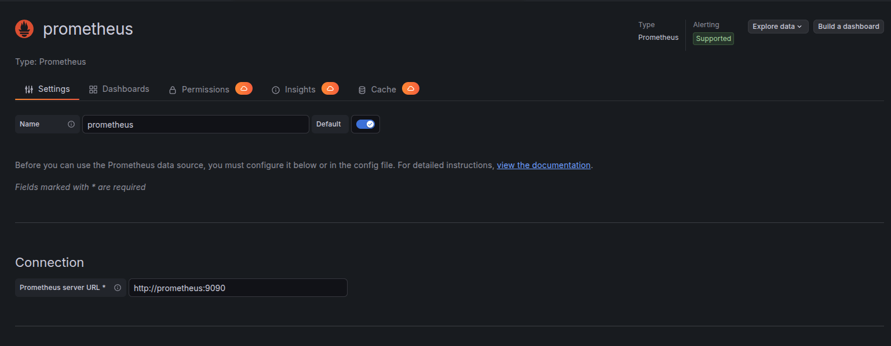

### Configure Loki Data Source

1.  Click **Add data source** again and select **Loki**.
2.  Set the **URL** to `http://loki:3100`.
3.  Click **Save & test**.

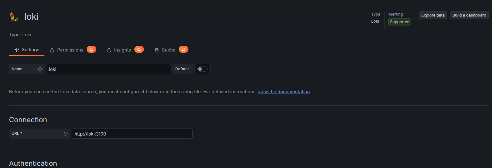

Once configured, you can go to the **Explore** tab, select **Loki**, and run a query to see your application logs flowing in.

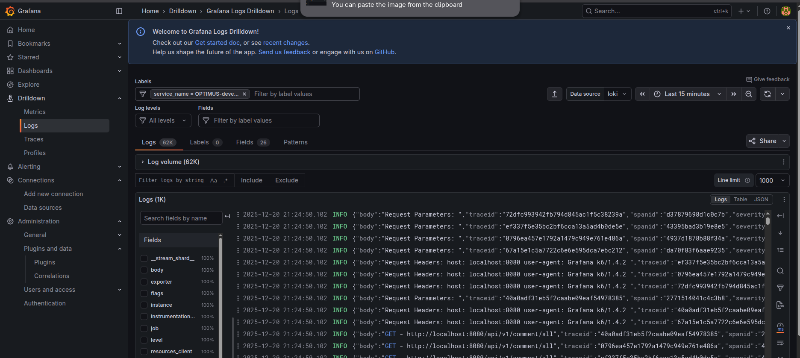

### Configure Tempo Data Source

1.  Click **Add data source** again and select **Tempo**.
2.  Set the **URL** to `http://tempo:3200`.
3.  Click **Save & test**.

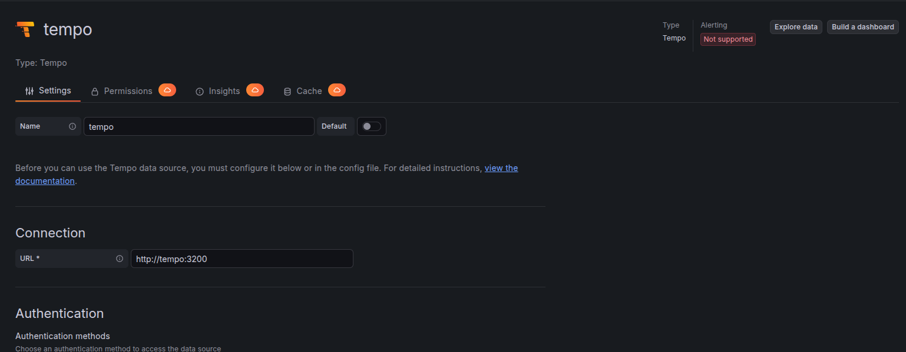

With Tempo configured, you can search for traces in the **Explore** tab. You should see a list of recent traces from your application.

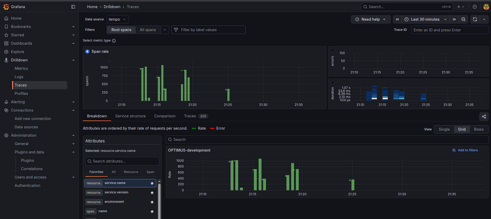

Clicking on a specific trace ID opens a detailed waterfall view. This visualization provides a complete breakdown of the request path, showing exactly how long each operation took and helping you identify performance bottlenecks.

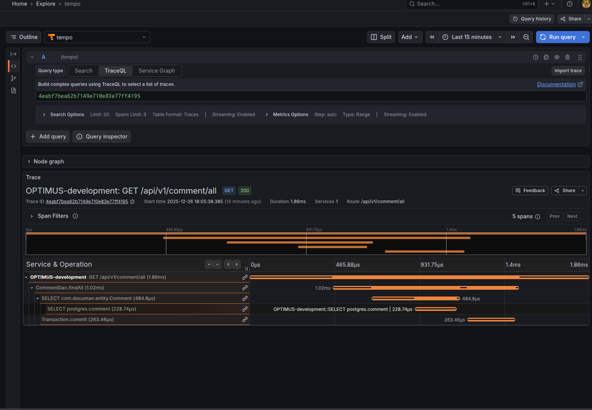

### Verify Data Sources

Finally, check your Data Sources list. You should have Prometheus, Loki, and Tempo configured. Ensure that **Prometheus** is set as the default data source.

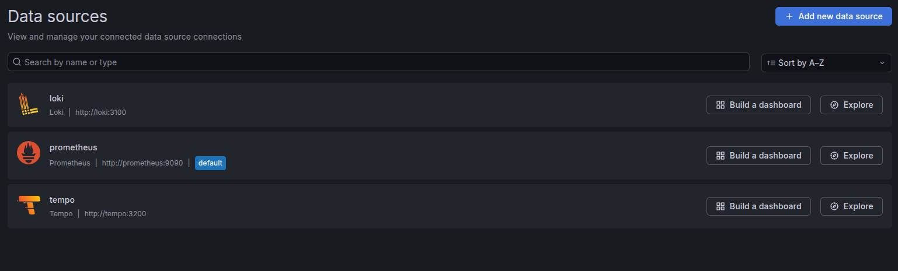

We have now successfully set up the basic visualization. Next, we will configure advanced settings in Loki and Tempo to enable seamless navigation between logs, traces, and metrics.

The diagram below illustrates the *Correlation Loop* we aim to achieve:
1.  **Metrics to Traces:** Using **Exemplars** to jump from a high-level metric spike directly to a relevant trace.
2.  **Traces to Logs:** Using tags (like `service.name`) and time ranges to find all logs associated with a specific request span.
3.  **Logs to Traces:** Extracting the unique `Trace ID` from a log line to instantly view the full request waterfall in Tempo.

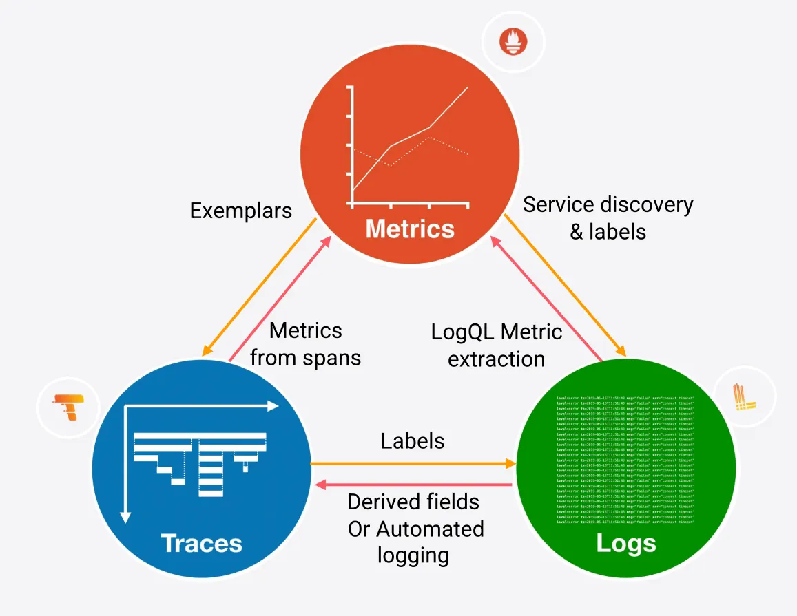


## Telemetry Correlation Setup

### Tempo Traces to Metrics

We can configure Tempo to link directly to metrics for any given trace. This allows us to see the performance context of a specific request.

1.  Go to **Connections** -> **Data Sources** and select your **Tempo** data source.
2.  Scroll down to the **Additional Settings** section.
3.  Find the **Trace to metrics** setting.
4.  Select your **Prometheus** data source.
5.  Under **Tags**, add a new tag: Key = `service.name`, Value = `job`.
6.  Add the following queries:
    *   **Request Rate:** `sum by (client, server)(rate(traces_service_graph_request_total{$__tags}[$__rate_interval]))`
    *   **Failed Request Rate:** `sum by (client, server)(rate(traces_service_graph_request_failed_total{$__tags}[$__rate_interval]))`

Now, when you view a trace in the **Explore** view, you will see a link icon. Clicking it reveals the request rate and failure rate graphs for that specific service, derived from your trace data.

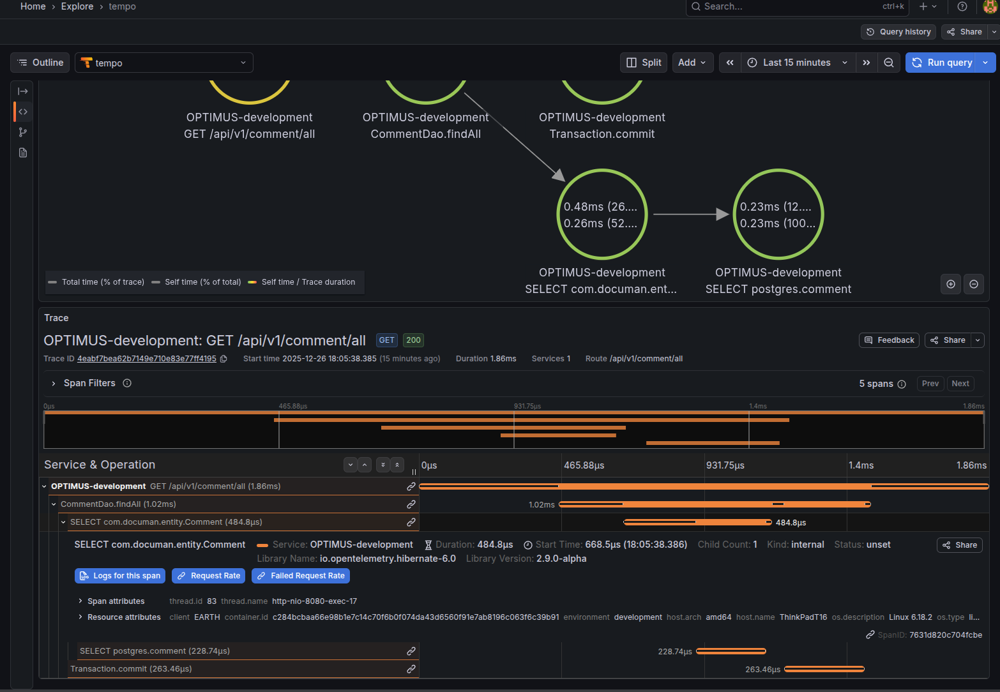

### Tempo Traces to Logs

We can also link traces to their corresponding logs.

1.  In the same **Tempo** data source settings, find the **Trace to logs** section.
2.  Select your **Loki** data source.
3.  Under **Tags**, add: Key = `service.name`, Value = `job`.
4.  Switch on **Filter by Trace ID**.
5.  Click **Save & test**.

Now, when viewing a trace, you will see a **"Logs for this span"** button. Clicking it will split the view and show you the exact logs generated during that span.

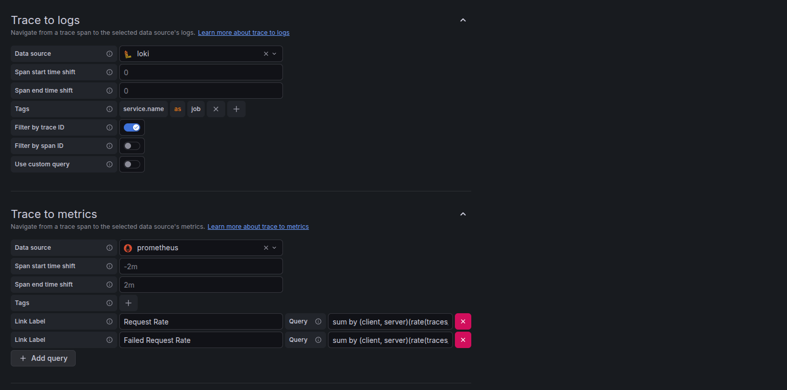

### Loki Logs to Traces

What if you spot an error in your logs and want to see the full trace? We can configure Loki to create a clickable link from the log line to the trace.

1.  Go to **Connections** -> **Data Sources** and select your **Loki** data source.
2.  Scroll to the **Derived Fields** section and click **Add**.
3.  Configure the field as follows:
    *   **Name:** `Trace ID`
    *   **Regex:** `"traceid"\s*:\s*"([^"]+)"` (This captures the 32-character trace ID from standard OTel JSON logs).
    *   **Query:** `${__value.raw}`
    *   **URL Label:** `View Trace`
    *   **Internal Link:** Enable this and select your **Tempo** data source.

Now, when you expand a log line in the **Explore** view, you will see a **"View Trace"** button next to the detected trace ID.

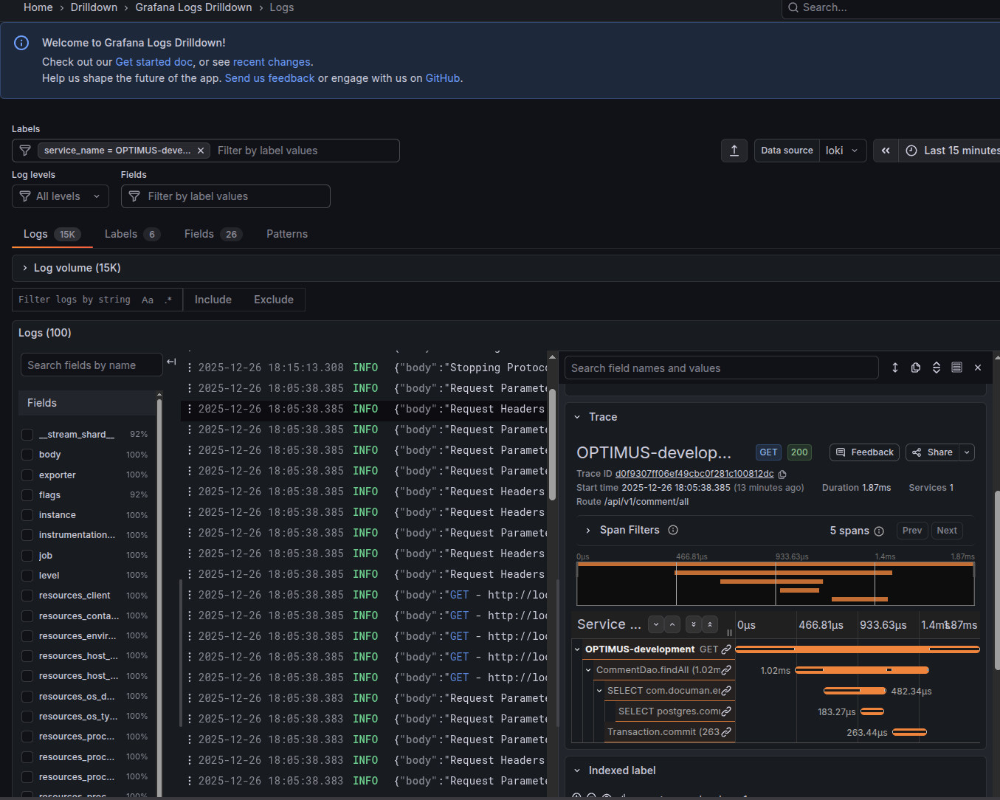

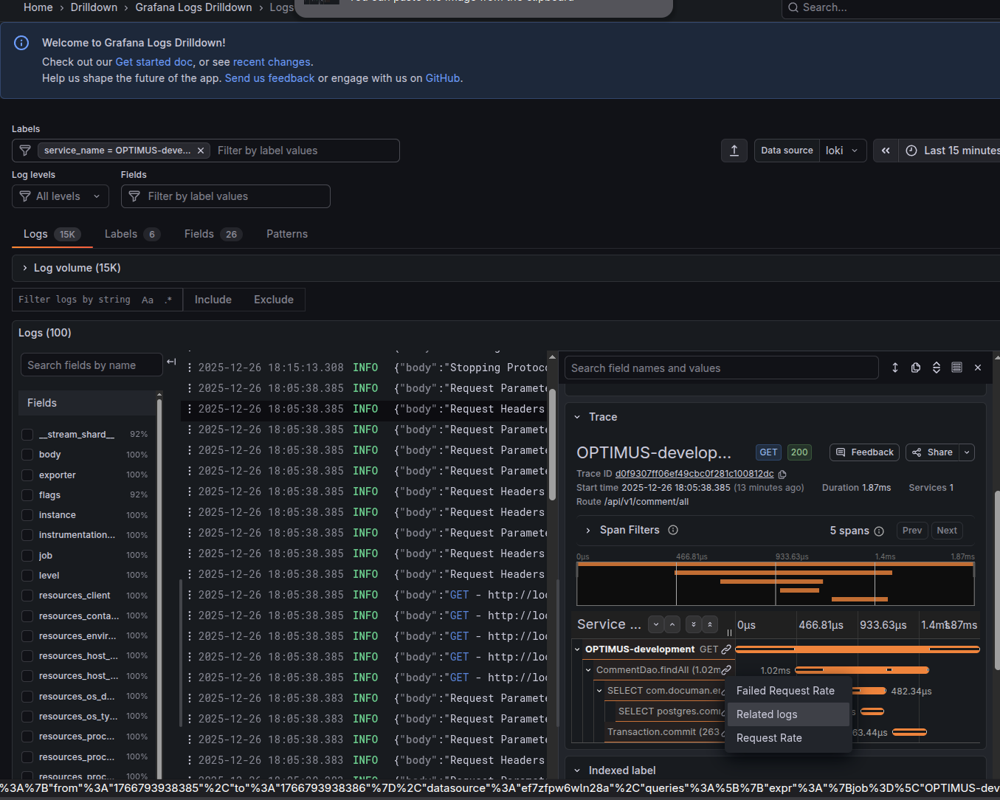

### Service Graphs and Node Graphs

In modern distributed architectures, particularly in the cloud, understanding the complex web of interactions between microservices is a significant challenge. **Service Graphs** and **Node Graphs** provide a dynamic, real-time visualization of your system's topology based on telemetry data.

#### The Power of Visualizing Distributed Systems

These graphs are powerful diagnostic tools that help you answer critical questions about your infrastructure:

*   **Dynamic Dependency Mapping:** They automatically discover and map dependencies between services. You can instantly see if a service is communicating with an unexpected database or if a legacy API is still receiving traffic. This "ground truth" view of your architecture is invaluable for system understanding.
*   **Cross-Service Bottleneck Detection:** By visualizing the **latency (Duration)** of requests between nodes, you can quickly identify "slow links" in your chain. If the connection between your `Order Service` and `Payment Gateway` is highlighted in red, you know exactly where to focus your optimization efforts without digging through thousands of individual logs.
*   **Error Cascade Analysis:** Distributed systems often suffer from cascading failures. Node graphs visualize **Error Rates** across connections, allowing you to trace the "blast radius" of a failure. You can visually follow the path of errors from a downstream dependency (like a failing database) up to the user-facing service that is reporting the 500 error.
*   **Traffic Volume & Load Balancing:** Using the **Request Rate**, you can identify hot spots and load imbalances. You can see if a specific service is being overwhelmed by traffic or if a new deployment has unexpectedly shifted load patterns.

#### The RED Method

These graphs are typically built upon the **RED** method metrics—**R**ate (traffic), **E**rrors, and **D**uration (latency)-which are derived directly from your trace data.

In our setup, the **Tempo** backend uses its `metrics_generator` component to analyze every span it receives. It calculates these RED metrics for every service-to-service call and exports them to **Prometheus**. Grafana then queries these metrics from Prometheus to render the topological view of your system.

#### Enabling the Graphs in Grafana

Since we have already configured the `spanmetrics` and `servicegraph` connectors in our OpenTelemetry Collector and Tempo, we simply need to enable this visualization in Grafana.

1.  Go to **Connections** -> **Data Sources** and select your **Tempo** data source.
2.  Scroll down to the **Additional Settings** section and find **Service Graph**.
3.  Select your **Prometheus** data source (this is where the generated span metrics are stored).
4.  Enable the **Node Graph** toggle.
5.  Click **Save & test**.

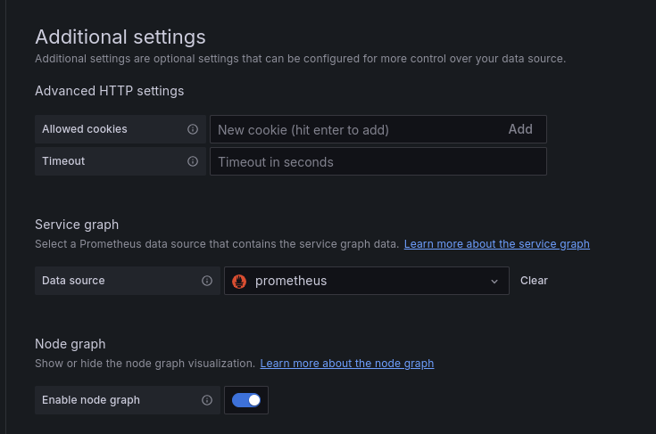

#### Exploring the Graphs

Once configured, head over to the **Explore** tab and select the **Node Graph** option. You will be presented with a directed graph representing your system's components and their real-time dependencies.

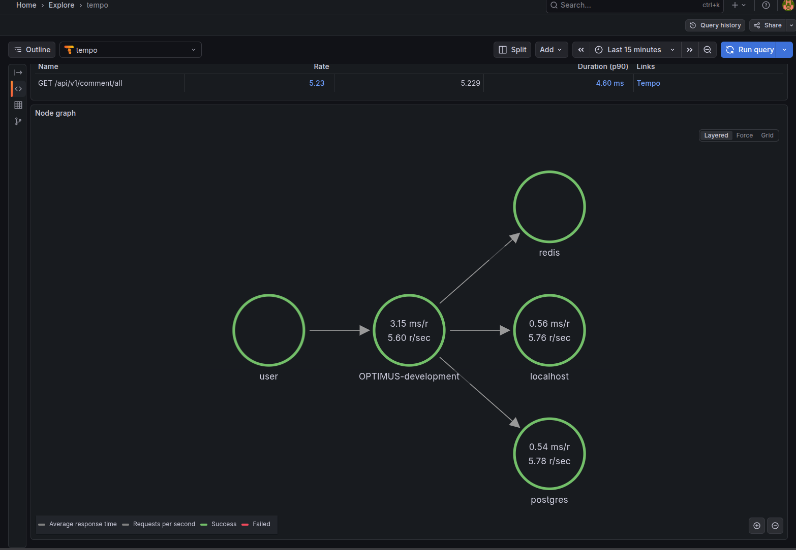

*   **Nodes:** Represent your services or components (e.g., databases, external APIs).
*   **Edges:** Represent the requests flowing between them.

Clicking on a node or an edge provides detailed context-specific metrics, allowing you to drill down from a high-level architectural view into specific performance indicators.

You can also switch to the **Service Graph** view, which provides a tabular summary of these interactions, highlighting the Request Rate, Error Rate, and Duration for each connection, making it easy to sort and spot the worst-performing dependencies.

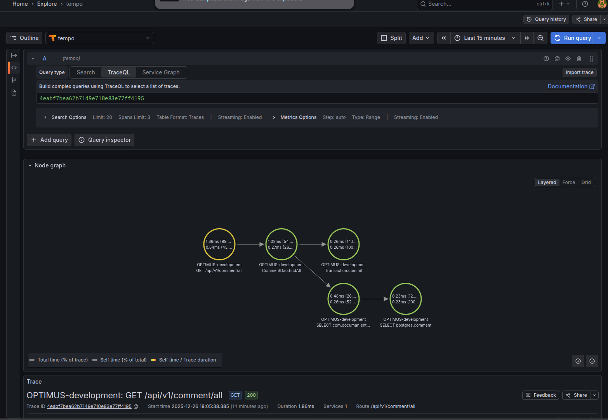

## Demo Video

To see all of these concepts in action, check out the following demo video. It walks through the entire setup, exploring traces and logs in Grafana and also how to view the logs for a trace and traces for a log line along with service and node graphs.



## Conclusion

I believe that every engineering team should prioritize setting up a robust observability stack. It doesn't have to be overly complex; even a minimum viable setup enables teams to be well-informed and proactive. Instead of waiting for users to report errors, you can detect and deduce issues immediately. With the ability to move seamlessly from traces to logs and metrics, teams can pinpoint the root cause of issues and deploy fixes much faster.

In the era of AI applications, observability has become a crucial part of MLOps. Metrics such as "Time to First Token" and "Tokens Per Second" matter immensely, as they directly impact a model's user experience and, consequently, the success of the product.

Thank you for reading until the end. The entire ecosystem of observability has matured a lot and is picking up much more traction than before. When I was trying to figure out ways to extract information to measure performance metrics two years ago, I stumbled upon the Cloud Observability domain. It is very vast, and this post just touches the tip of the iceberg. I hope this helps you to get started with Observability in Spring Boot. Feel free to make modifications to the configuration files as per your needs. Medium posts and forums are great places to see what others have been able to setup with different vendors and are a great starting point to get started with your own setup.

## References

- [Prometheus](https://prometheus.io/)
- [Micrometer Application Observability](https://micrometer.io/)
- [Grafana OSS and Enterprise](https://grafana.com/docs/grafana/latest/)
- [Grafana Loki](https://grafana.com/docs/loki/latest/)
- [Grafana Tempo](https://grafana.com/docs/tempo/latest/)
