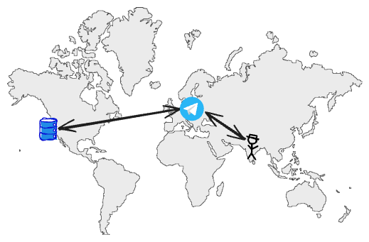
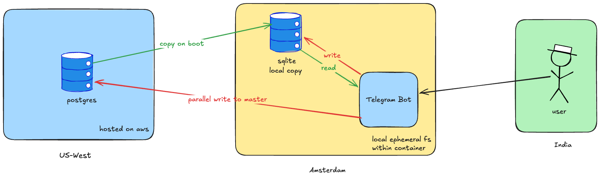
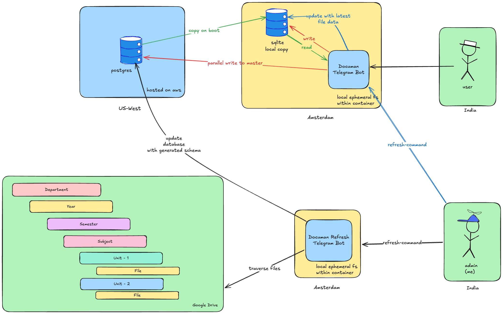
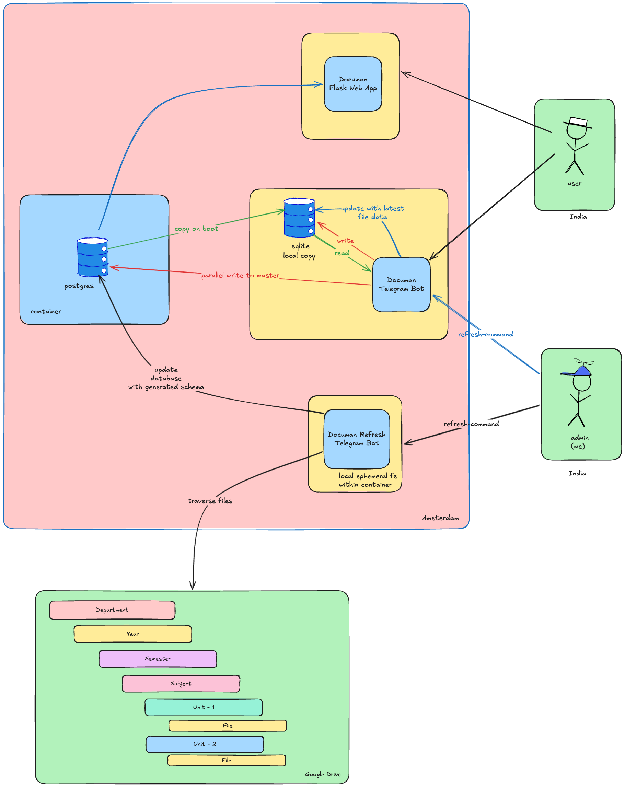
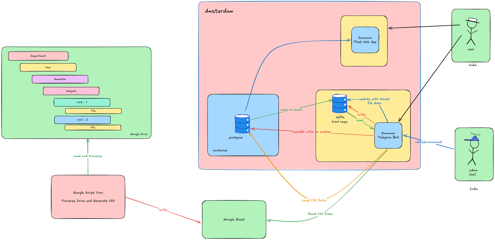

Documan is a project I built to solve a small, annoying problem at my college, and then ended up running for five years. Over that time it served around 4,000 students, delivered a couple hundred thousand files, and never cost me a single rupee to run. That last part is important, because almost every architectural decision in this post exists because I refused to pay for anything.

I documented most of this journey as it happened, on the Telegram channel where the bot lived, so this isn't me reconstructing things from memory and quietly making myself look smarter than I was. The dates and the changelogs are real. One honest caveat though: I only started using version control a few months into the project, so the earliest commits in the archived repo postdate the launch. For the first stretch, the timeline here comes from those Telegram changelogs and from memory rather than from git.

I'm also writing this now because I'm retiring the project. It isn't in use anymore, I started a rewrite, learned what I wanted to learn from it, and I'd rather publish the whole thing as it stands than let it disappear quietly.

# Why Documan?

My college had study material scattered everywhere. Notes, course files, lab manuals, previous question papers, all of it sitting across various Google Drive folders and getting shared by hand over WhatsApp and Telegram whenever someone needed something. There was usually one person who happened to have the files, and that person became the bottleneck for everyone else.

Documan removed that bottleneck. It put the whole catalog behind a single interface, organized the way the material was actually organized, and let any student pull what they needed without going through a human.

The files themselves always stayed in Google Drive; I never wanted to host the storage. What Documan did was index that Drive structure and serve it fast, first through a Telegram bot, and later through a web app as well.

# The naive start

The first version went live in September 2020 as a Telegram bot and nothing else, after some testing over the preceding summer. The bot ran on Heroku's free tier, the database was a Heroku-hosted Postgres instance sitting in US-West, and the users were in India. I was in India too.

_The first setup: a Telegram bot talking to a Postgres instance an ocean away._

This worked, in the sense that it returned files. But it was slow, and it took me a while to understand why. Every interaction, every menu tap, every search, was a round trip from a phone in India, to a bot process, to a Postgres database on the other side of the planet, and back. The few seconds of delay weren't a code problem, they were a geography problem. The data lived an ocean away from everyone using it, and no amount of cleverness in the query layer was going to beat the speed of light.

I didn't frame it that cleanly at the time. I just knew it felt sluggish and I wanted it to feel instant.

# The change that actually mattered: a local copy

The bot was slow from the moment it launched, and the geography problem was obvious enough that I went after it within the first couple of months. The fix that did the real work was giving the application a local database to read from, instead of reaching across the Atlantic on every single request.

_A local SQLite copy hydrated on boot, with writes fanned out to the Postgres master in parallel._

The container ran in Amsterdam. On boot, it copied the data out of the Postgres master in US-West into a local SQLite database living on the container's own filesystem. After that, every read the application needed came from that local copy. No network hop, no transcontinental wait. Reads went from a few seconds to effectively instant.

The writes were the part I had to think about. I didn't want to give up Postgres as the source of truth, so writes went to both places. The local SQLite copy got the write so local state stayed correct, and the same write was sent to the Postgres master in parallel so the canonical database stayed up to date. The master stayed authoritative, the reads stayed local, and the parallel write meant the write path never blocked on the slow connection.

This single change is what solved the latency problem. Everything that came after it was either operational housekeeping or a different kind of speed entirely, and I want to be upfront about that, because the easy thing to do in a post like this is make every change sound like a breakthrough. This one was the breakthrough. The rest were not, and one of them did nothing for latency at all.

Around the same time, I also moved the bot off its polling loop and onto webhooks, so Telegram pushed updates to it as they arrived instead of the bot constantly asking. It was cheaper to run and a better fit now that the reads underneath were already fast.

One detail that matters later: the SQLite copy lived on the container's ephemeral filesystem, which meant it was rebuilt from the master every time the container restarted.

# The feature I had the most fun with

With the bot now fast and pleasant to use, I added the feature I enjoyed building more than any other in the entire project.

In December 2020, about three months after launch, I added inline support, and announced it publicly in the 2.0 release at the start of January 2021. Inline meant a student could summon Documan from inside any chat, type a query, and get results without going to the bot's own conversation first. It made the whole thing feel like it belonged to the platform rather than sitting off to the side, and I really enjoyed wiring it up, probably because it was the first feature that was about delight rather than fixing something broken. Later updates made inline faster and let it carry file details and even images, but the first version was the one I had the most fun with.

I mention it because it's easy to assume a feature like inline came late, once a project is mature. It didn't. It was one of the first real things Documan could do, added barely three months in, right after I'd gotten the speed sorted.

# Going async: the April 2021 refactor

By early 2021 the bot was still a single, growing `main.py`, and it was getting unwieldy. In April 2021 I did the biggest refactor of the whole project, splitting that monolith into proper modules: database access, keyboards, helper functions, and configuration each got their own file. This is roughly the point where I started to understand what modular code was actually for, mostly because I'd made the file painful enough to need it.

The more important part of that refactor was making the bot async. Until then, the message handlers did their database work synchronously, so every interaction blocked on a write before it could move on, and under load those writes stacked up. I moved DB writes onto a queue-based background thread: the handler dropped its write onto a queue and returned to the user immediately, and a background worker drained the queue and pushed everything to the database on its own time.

This had two effects. The obvious one was logging. I'd started collecting command usage metrics around the same time, and writing a metrics row on every single interaction would have put database work right back onto the path I'd worked to clear; the background queue meant the user never waited on any of it. The bigger effect was concurrency. With writes off the request path, handlers returned fast and concurrent users stopped queuing behind each other. Around April 2021 this landed as the single most visible speed jump of the whole project, up to roughly 5x faster when multiple people were using it at the same time.

It's worth being precise here, because this is a different kind of speed from the local copy. The local copy fixed how long any one request took. Going async fixed what happened when many requests arrived together. Users felt both, but they came from solving two separate problems.

# Two bots, so I'd stop restarting the app

Because the local SQLite copy was hydrated on boot, refreshing the catalog meant restarting the application. Every time new material went into the Drive and I wanted Documan to know about it, I had to bounce the serving app just to rebuild its local copy. That is a bad way to run something people are actively using.

_One bot serves users, a second bot handles refresh, so the serving app never has to restart._

The fix was a second bot. One bot served users, the other handled refresh. When I sent it a refresh command, the refresh bot walked the Drive folder structure, generated the schema from it, updated the database, and pushed the latest file data into the serving side's local copy. The serving app stayed up the entire time. No more restarting a live application just to tell it about new files.

This split, one path for serving and one path for ingesting, is the shape the system kept for the rest of its life.

# But why did moving everything to my own server change nothing?

Eventually I used up all of my Heroku student credits, which knocked me off the free plan, and I wasn't going to start paying. By this point, around September 2021, I'd also launched the web app, which opened Documan up to anyone on desktop or mobile who wasn't on Telegram, and the web app didn't fit comfortably in what the free tier allowed alongside everything else. So the choice was pay or leave, and I left.

_Everything consolidated onto a single self-hosted server, with the web app added alongside the bot._

I moved everything onto my own server running on DigitalOcean student credits. And because the Postgres master had also been Heroku-hosted, the database had to come along too, so I ended up hosting Postgres myself, in a container, right next to the application.

To be honest, co-locating the master database with the app had no effect on latency. None. You might assume that putting the database next to the application is what made things fast, and for a lot of systems that would be the story, but I'd already solved the read latency with the local SQLite copy a long time before this. By the time Postgres moved, the reads were already local and already instant. Moving the master next to the app just gave the parallel writes a shorter trip, which nobody could feel.

I'm keeping this section in because the move was real and it was forced, and pretending it was a performance win would make this post useless. The reason Postgres moved is that my free credits ran out on one provider and I shifted to free credits on another. That's the whole reason. The diagram changes, the user experience does not.

# Documan on the web

The web app started back in May 2021 as a parallel sprint alongside the bot, and by September 2021 it was public-facing. This is the version most people who weren't on Telegram ended up using.

It also wasn't just a file browser. Along the way it grew a student blog with a proper rich-text editor, comments you could toggle on or off per post, and a role hierarchy running from regular users up through maintainers, moderators, and admins.

The interesting architectural decision here was splitting the data across two databases. The read-only catalog, the files and subjects and course material, all of it derived from the Google Drive structure, lived in a local SQLite database that got rebuilt on refresh. Everything users actually created, accounts, blog posts, comments, lived in Postgres. The logic was simple: anything I could regenerate from the source went in the fast local copy, and anything I couldn't afford to lose went in the durable database. It's the same locality idea from the bot, just applied a bit more precisely.

For search, I didn't want to limp along on SQL `LIKE` queries, so I ran [[MeiliSearch]] as a sidecar container and indexed every file with its metadata, the name, subject, and code, all filterable by department, file type, and whether it was a course file. This is what made search on the web version much faster around October 2021. A few months later, in January 2022, I added a guest login so students could browse the whole catalog without even making an account.

And the files themselves? Same as always, nothing was ever hosted on my server. The view and download routes just built the Google Drive URL from the stored file ID and redirected the browser there.

One of my favourite production gotchas came from exactly this. I'd been using the Google Drive file ID as the primary key for catalog entries, which is fine right up until the same file shows up in two different places in the catalog and the IDs collide. The fix was boring, just switch the primary key to a plain autoincrement integer, and I even named the new column `dummy_id`, but figuring out why entries were occasionally clobbering each other is the kind of debugging you only ever get from running something in production.

# The first year, in numbers

By the end of 2021, Documan had been live for over a year and had crossed 550 users on Telegram. Across that year the bot sent something like 60,000 files, and going by the size of the material it served, it saved students a few hundred gigabytes of downloads and re-downloads they'd otherwise have juggled by hand. It ran as two front ends by then, the bot and the web app, and went through eight or so feature releases over the year.

The scope grew alongside the architecture. It started narrow, just a couple of years of one department's material, and by late 2021 it covered every year of the ECE department. Supporting more than one department meant a schema redesign around that time, moving to a table per department and adding a dedicated table for course files. Other departments followed in early 2022, with CSE Content added that February. Walking that many Drive folders also pushed against what a single Google account's API limits would comfortably allow, so I split the traversal across two separate Google credentials, one set covering some departments and another set covering the rest. So the system wasn't just getting faster over this period, it was carrying more.

None of these are huge numbers in absolute terms. But they were real students getting real course material, every day, off something that cost nothing to run, and at the time it was honestly hard for me to believe it was holding up.

# But why was the refresh so slow?

The remaining slow thing was the refresh itself, and this was the last big change I made, around the middle of 2022.

The catalog came from a Drive folder structure that was six levels deep: department, then year, then semester, then subject, then unit, then the files. Walking that meant a nested traversal six levels down, and a full refresh took somewhere between ten and thirty minutes.

For a long time I assumed the loop was the problem. It wasn't. The problem was that every step of that walk was a Google Drive API call made from my server, over the network, to Google. The traversal code itself was fine. What was slow was thousands of remote API calls, each one waiting on a round trip to Google and back.

_The same traversal, moved into a Google Apps Script that runs next to the files and emits a flat CSV._

The fix was to stop running the walk from my server and run it where the files already were. I moved the exact same traversal into a Google Apps Script that ran on Google's own infrastructure on a schedule. Same logic, same six-level nested walk, no algorithmic change at all. But now the calls were internal to Google, and internal calls came back far faster than the same calls made from outside. The script traversed the Drive, generated a flat CSV describing the whole catalog, and wrote it to a Google Sheet. Documan then just read that CSV and loaded it.

The refresh dropped from ten-to-thirty minutes down to about 5 minutes. I didn't make the code any smarter; I moved the code next to the data it was hammering, and the latency hiding in every API call mostly went away.

If you've been paying attention, this is the same lesson as the local SQLite copy, arriving a second time from a different direction. Both times the speed problem was distance, not the program. The first time I moved the reads close to the user. The last time I moved the traversal close to the files. The actual logic in between barely mattered.

# What this whole thing was really about

The thread running through all of this is that I never had money to throw at the problem, so I kept solving things by moving work to wherever it was cheap or free. A managed read replica would have fixed the read latency; instead I copied the database into the container for free. Paid API quota would have sped up the Drive walk; instead I ran the walk on Google's own machines for free. A bigger Heroku plan would have kept everything in one place; instead I moved to another provider's free credits and self-hosted. Five years, around 4,000 students served, and not a single rupee spent.

The engineering came out reasonably good, but it came out good because it was forced. I didn't have the option of buying my way past a problem, so I had to actually understand each problem well enough to route around it.

And here's the part I think matters most. When I started, I didn't know object-oriented programming. I didn't know most of what I ended up doing. I learned Python because I needed it, SQL because I needed a database, server management because I needed to host things, and Docker because I needed to package them. Each of those showed up because a specific problem demanded it, and I learned exactly as much as I needed to get past that problem, and not much more. That is a slower way to learn than sitting down with a curriculum, but the things you learn that way stick.

The part I remember most fondly isn't any of the architecture, though. It's that the users could feel the speed change. When the reads went local and the thing started responding instantly, people noticed and said so. Building something that a few thousand people use every day, and having them tell you it got faster, is a kind of feedback you just don't get from a project that only ever lives on your own machine.

# Where it ends

Documan was a pre-AI project. I wrote all of it myself, by hand, because that was the only option at the time, and that's part of why I wanted to put the whole thing down here. It ran in production for five years and real people depended on it.

It isn't running anymore. The college's needs changed, I moved on, and at some point I started a rewrite with a Java 21 backend and a new frontend, mostly to see how I'd build it now with everything I've learned since. I got partway through, learned what I wanted from the exercise, and stopped.

So I'm releasing all of it. The final version of the bot, the web app, and everything else I have as of today, alongside the partial Java 21 rewrite, all published in the state they're in. This isn't a product launch, it's an archive. It's proof of work I can look back on years from now, and a chance to share my spaghetti code with you all. The original Documan did its job for five years on a budget of nothing, and I'm content to leave it there.

You can find the full archive on my GitHub: [documan-public-archive](https://github.com/theinhumaneme/documan-public-archive).

You can find the backend re-write on my GitHub: [documan-java-21](https://github.com/theinhumaneme/documan-java21).

Thank you for reading until the end.
