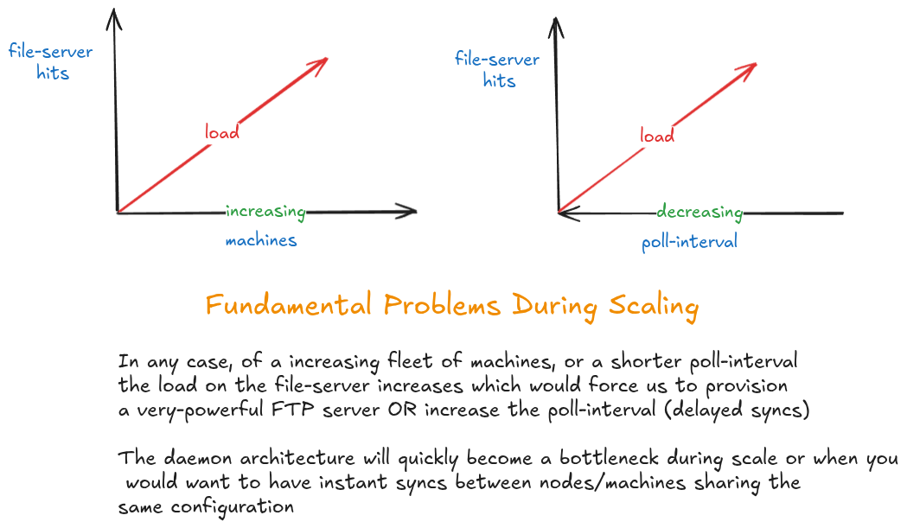
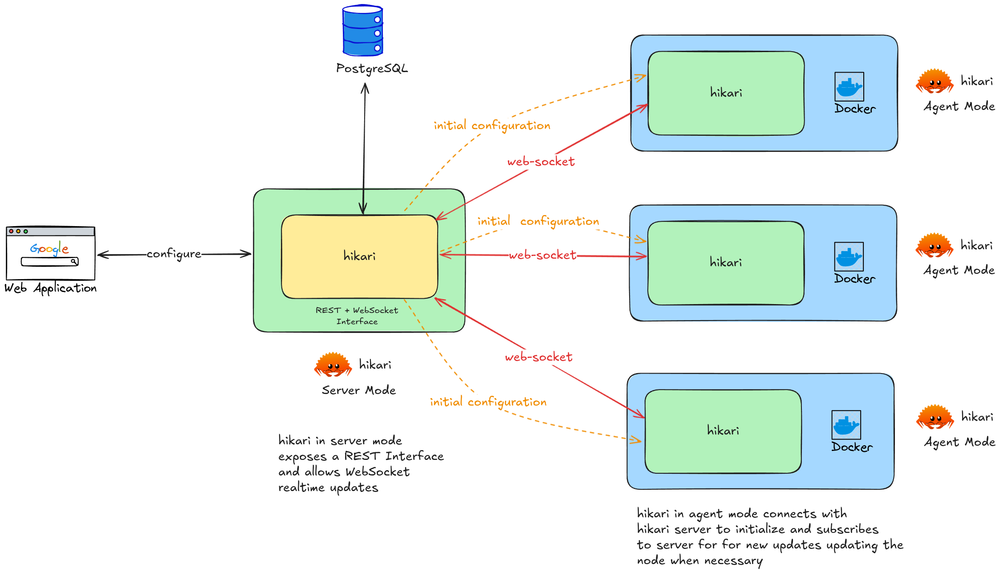
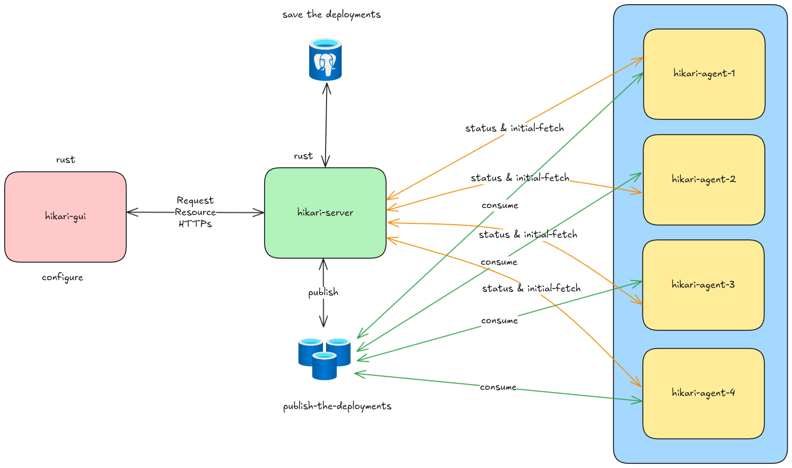

Hikari has just received a significant upgrade, which allows it to manage multiple nodes at scale while having seamless real-time updates; this update was quite a natural feature addition to address the problems Hikari is aimed at solving, which was previously not possible in Daemon Mode.



### But.... Why an Agent-Sever Model for Hikari?

While using Daemon Mode and planning to expand your fleet of machines from a few to 10's of machines or even more, the management of these many configurations would become really difficult really quick. You'd have to choose to use a huge JSON file, which is really hard to handle after some time, or you'd have to fragment the files into multiple smaller ones and manage them separately; this is not really good when you are planning to manage multiple machines and environments at the same time.

The previous model also utilized a poll-based mechanism that would query your file server every `t` seconds and look for changes; at times, you'd have almost no deployment changes for days or even months, depending on your client or solution domain. However, the daemon would still query your file server, consuming bandwidth and CPU time, which is not ideal when using multiple machines with Hikari.

Given the problems discussed above, a natural thought would be to increase the polling time to reduce the file-server queries; however, doing so introduces a significant delay in how quickly we can distribute the configuration to all the required nodes.



## Hikari Agent-Server

Hikari can now operate two brand new modes [Server](#server) and [Agent](#agent)

### Current Agent-Server Architecture



This model enables the server to push updates to clients the moment they are published, and clients connected to the server can sync in real time, ensuring your deployments are available everywhere within seconds of publication.

### Server

A standalone instance of Hikari exposing a REST API to modify the objects and persist them in a PostgreSQL database and a WebSocket interface to push updates to the connected clients, the web server uses by the  crate which is powered by the amazing async rust runtime [tokio](https://tokio.rs/), data layer handled by  crate that enables compile-time safety for all the SQL queries in the application.

The server implements a broadcast channel system using Tokio's async channels, with each client-environment-solution combination receiving its own channel for targeted updates. WebSocket connections are managed with proper cleanup and error handling, supporting concurrent connections ensuring minimal resource overhead.

### Agent

Communicates with the Hikari Sever to pull the latest changes and establishes a persistent connection to listen for configuration updates, incorporating a clever backoff strategy to always be ready to reconnect if the server instance were to go down.

The Agent Mode utilizes the same intelligent logic as the Daemon Mode to handle changes in the incoming configuration and manage the containers on the machine, ensuring seamless deployments everytime.

### Features

1. Scalable Architecture that can handle up to **5000 rps** (in my testing)
2. Robust Pub-Sub Model through WebSocket with minimal latency
3. Improved Logging
4. Robust Configuration Management
5. Expanded Binary Support
   - Linux AMD64 (x86_64) glibc and musl binaries
   - Linux ARM64 (aarch64) glibc and musl binaries
   - Windows 64bit (x86_64) .exe binary


### Security

Currently, Hikari Agent-Sever Mode does not offer support for extensive security features in server mode, as it was designed primarily as an internal tool. As of the time of writing this blog post, it is recommended that you run the Hikari server behind a reverse proxy that can terminate SSL connections, such as Nginx, and provide the SSL Certificates for TLS in transit through Let's Encrypt.

The Daemon Mode still has the same security features available as before.

### Getting Started with Hikari Agent-Server

#### Server Configuration

The server mode requires a running PostgreSQL instance and several environment variables; the following is a sample configuration for the server component.

- environment variables

```env
POSTGRES_HOST=localhost
POSTGRES_PORT=5432
POSTGRES_DATABASE=hikari
POSTGRES_USER=hikari
POSTGRES_PASSWORD=hikari
```

#### Agent Configuration

The agent mode, similar to the daemon mode, would require the `client,` `environment,` and `solution` configuration to identify the targeted resources, `HIKARI_SERVER_DOMAIN` to connect to the Hikari server and the path for the `reference_file_path` from the `config.toml` to compare the current and the incoming changes.

#### Configuration Files

- config.toml

```toml
reference_file_path = "reference.json" # filename & path where the current node config will be stored
```

- node.toml

```toml
version = "1"
solution = "hikari"
client = "hikari"
environment = "hikari"
```

- environment variables

```env
HIKARI_SERVER_DOMAIN=hikari.domain.tld
```

### But why WebSockets?

In this project, I have implemented WebSockets as they reduce the number of components required to get started initially. It is not expected that WebSockets will be able to handle large amounts of traffic during extreme loads.

What you see below is the initial diagram designed to implement the Agent-Server Model.



Since then, during development, I had made some decisions that I felt were important to ensure that Hikari is as lightweight as possible while using minimal resources to get started.

### Redis (Cache and Pub-Sub) / Message Brokers

I had eliminated Redis as the WebServer would not benefit from a Cache Server at this point in time, and this would increase the infrastructure complexity of the application as this component's primary use case was to act as a message broker.

### PostgreSQL (LISTEN-NOTIFY)

PostgreSQL has a built-in pub-sub model called LISTEN-NOTIFY. However, as you have to connect to the database, it is not a safe decision to use a database for a pub-sub model, even if you were to impose strict role-level permissions.

## Conclusion

Hikari is purpose-built for those seeking a lightweight, cost-effective, and secure solution for managing cloud deployments. Whether you're handling a handful of VMs or a specific use case for each node, Hikari eliminates the overhead, empowering you with a straightforward and seamless deployment process.

Source-Code for hikari, if you have any new ideas, you can raise a Pull Request and I would be happy to merge it :D

 

Understand Hikari on DeepWiki - Hikari DeepWiki


Hikari was the first application that I wanted to build in Rust, [AutoDeploy](../hasslefree-deployments-with-autodeploy/) was a test to see if I could build applications in Rust. I really enjoyed the process of building Hikari!

Read About AutoDeploy
---



Thank you for reading until the end.